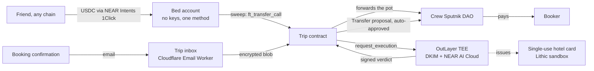

# Dibs

**Every bed paid before anyone books.** Group-trip money on NEAR: friends pay for their own bed from any
chain, nobody can book until every bed is paid, a dropout cannot get a refund but can sell their bed at face
value to someone already waiting, and the money is released only when the trip's own inbox receives a real,
verified booking confirmation.

**[Open the live Lisbon trip](https://dibs.larinova.com/t/lis0312)** ·
[Five-minute judge path](JUDGES.md) · [Threat model](docs/THREAT_MODEL.md) · `pnpm verify` (reads the chain, no keys)

Built at NEAR HACKATHON, November 2026. The full product runs on NEAR testnet, and the pay-in also runs on
**NEAR mainnet with real USDC** ([Live on NEAR mainnet](#live-on-near-mainnet-real-usdc)). Card rails are the Lithic
sandbox (details in [Honest limits](#honest-limits)).

## The problem

> "Last year, I had to pay $600 from my pocket as everyone was saying 'pay me later.' Only half of them actually
> paid me later, though." A group-trip organiser on Reddit, February 2026.

One friend books the place and then spends weeks chasing everyone. Shared pots move the problem instead of solving
it: now everyone has to trust whoever holds the pot, and whoever books.

## What Dibs does

| Rule | Enforced by |
|---|---|
| Nobody books until every bed is paid | The trip contract counts beds; the pot sits in the crew's own Sputnik DAO |
| Pay from any chain | Every bed is its own keyless NEAR account; NEAR Intents 1Click delivers USDC into it from Base, Solana, Arbitrum or Ethereum |
| No refunds. Sell your bed at face value | `request_refund` always fails with `E_NO_REFUND`; `list_for_resale` has no price parameter; a pre-funded waitlist buys the bed in the same call |
| The booker never holds the money | When every bed is paid, an OutLayer enclave issues the trip a single-use card that works only at hotels, up to the pot, sealed to the booker's passkey |
| Money moves only for a real booking | The confirmation lands in `<trip>@dibs.larinova.com`; OutLayer checks its DKIM signature in Intel TDX, NEAR AI Cloud reads it privately, the contract verifies the signed verdict, and the DAO pays |
| Beds are drawn fairly | OutLayer VRF output, verified by the contract, seeds the bed assignment |
| No booking by the deadline | Every bed is refunded automatically (`refund_all`) |

## Live on NEAR testnet

| What happened | Evidence |
|---|---|
| A **real booking.com confirmation** (Carlton City Hotel Singapore) verified on chain: DKIM `d=booking.com` checked in OutLayer TDX, read by NEAR AI Cloud, signature checked by the contract | [`54g9Y2qg…`](https://testnet.nearblocks.io/txns/54g9Y2qgKPNFamFeN6tQUgpR1AqU322F1J184LB8mYKr), trip `sin1025`: 25–26 Oct 2025, 2 guests, SGD 226.60 |
| The crew DAO paid the booker **226.60 USDC** with no vote, because the proof passed | `get_trip sin1025` → `payout: Done` |
| Beds drawn by **OutLayer VRF** | [`3RDs4qUK…`](https://testnet.nearblocks.io/txns/3RDs4qUK27Jfthi1NhNz7hsoYJtmh5N6j5o1BtjQfBSV), trip `lis0312` |
| A refund asked for and refused by the contract | `E_NO_REFUND`, see `pnpm verify` |
| The trip's own card: hotel charge **approved**, electronics charge **declined** | Lithic sandbox, issued by the enclave for `lis0312` (last4 0810) |
| Contract test suite | **46 of 46 checks pass, 35 of them attacks**, each refused with its own code ([judge-report.json](contracts/judge-report.json)) |

Every line above is re-checked by `pnpm verify`.

## Live on NEAR mainnet (real USDC)

The same contracts, deployed to mainnet as `dibsapp.near`, with the crew pot in `dibs-lismain.sputnik-dao.near`. The app
switches to mainnet for trips [`lismain`](https://dibs.larinova.com/t/lismain) and
[`lismain2`](https://dibs.larinova.com/t/lismain2); the API serves them at `api.dibs.larinova.com/mainnet`.

| What happened | Evidence |
|---|---|
| Contract deployed and initialised; bed accounts carry mainnet USDC in their code | [`A2FUVBt9…`](https://nearblocks.io/txns/A2FUVBt9MDmu1hSWmBPFKeEHjDoCapgWZ8Js2akhzym5) |
| Trip `lismain` (2 beds at 0.25 USDC) created with its own keyless bed accounts | [`9ozojmPQ…`](https://nearblocks.io/txns/9ozojmPQeaVxggfLG7HzD1UcP1SNhRuUjA6LtcYKGYTM) |
| Bed 2 paid with **real USDC on NEAR**: held, sent to the bed's own account, swept into the crew DAO | hold [`bSgWocNV…`](https://nearblocks.io/txns/bSgWocNVUk3ce7EXSemN49PA5bTZDvJYGmBZvgniKfY), deposit [`6W5hd6Bu…`](https://nearblocks.io/txns/6W5hd6BUuQUYnACD792DaEVb7osLBXdQNGB1MMSvGZYf), sweep [`GKYgYFwf…`](https://nearblocks.io/txns/GKYgYFwfTdEbqe1wPcaxFQBNDvmM2btG8zb5fE2YPp1N) |
| Bed 1 held through the app for a live NEAR Intents 1Click quote from Base (0.252579 USDC in, exactly 0.25 out) | awaiting the Base deposit |

Mainnet is deliberately narrow. Its API answers only the pay-in (trip reads, hold, 1Click quote, deposit submit, status
and sweep); trip creation, proofs, the draw, the card and gasless relays are refused with `E_MAINNET_SCOPE` and run on
testnet. It has its own relayer, `relayer.dibsapp.near`. All ids: [deploy/mainnet.json](deploy/mainnet.json).

### Pay with your wallet

On a mainnet trip the pay sheet offers the friend's own wallet before the copy-and-send route:

- **EVM wallets** (MetaMask, Rabby, Coinbase, Brave…) found through EIP-6963. One tap connects, uses the wallet's
  address for refunds, puts the wallet on Base, Arbitrum or Ethereum (adding the chain if needed), checks its USDC,
  holds the bed, gets the 1Click quote and asks the wallet to send exactly `amountIn` to the deposit address. The
  transaction hash goes to 1Click's `deposit/submit` so the swap starts sooner.
- **Solana wallets** (Phantom, Solflare, Backpack…) found through the Wallet Standard. The wallet signs and sends one
  transaction: create the deposit address's USDC account if it is missing, then a USDC `TransferChecked` of exactly
  `amountIn`. Checked against mainnet's `simulateTransaction` before shipping.
- **NEAR wallets** through NEAR Connect (`@hot-labs/near-connect`: HOT, Meteor, Intear, MyNearWallet, NEAR Mobile,
  Ledger and more). The wallet sends USDC straight to the bed's own account with one `ft_transfer`; no swap is needed.
- **No wallet:** the one-time address, the exact amount and a QR that wallets read (EIP-681 on EVM, Solana Pay).

## How it works



- **Trip contract** (`contracts/dibs`, near-sdk 5): trips, beds, waitlist, resale, refunds, proofs. Every rejection
  carries a stable code (`E_*`) listed in [INTERFACE.md](contracts/INTERFACE.md).
- **Bed accounts** (`contracts/bed`): 2 KB raw wasm, no keys, one method that forwards exactly what arrived.
- **Verifier** (`outlayer/verifier`): a wasm32-wasip2 app for OutLayer. Ops: `booking` (DKIM, NEAR AI extraction,
  ed25519-signed facts), `vrf`, `card` (issues the Lithic card with a sealed key and seals the number to the booker).
- **API** (`services/api`, Cloudflare Worker): 1Click quotes and status, the gasless relayer (NEP-366, allowlisted
  methods only), encrypted proof blobs, names, activity.
- **Inbox** (`services/inbox`, Cloudflare Email Worker): unwraps forwarded-as-attachment emails byte for byte so
  DKIM still verifies.
- **App** (`apps/web`, React + ReUI): passkey-derived keys (WebAuthn PRF), no wallet, no gas.

## NEAR doing real work

| NEAR piece | Its job here |
|---|---|
| Sputnik DAO (+ Trezu view) | Holds each crew's pot; a `trip` role lets only the contract propose and approve the payout |
| NEAR Intents 1Click | Any-chain pay-in to a bed account, EXACT_OUTPUT quotes, live on mainnet |
| NEAR Connect | A friend's NEAR wallet pays their bed directly on mainnet |
| OutLayer | Verifiable compute the contract itself calls: DKIM check, private extraction, VRF, card issuing |
| NEAR AI Cloud | Reads the booking email inside a GPU enclave (Qwen3.8-27B, TEE-signed responses) |
| Keyless accounts and NEP-366 | Bed accounts with no keys; friends act through signed delegate actions, gas paid by the relayer |

## Try it in five minutes

1. `pnpm install && pnpm verify` re-checks everything in the table above against testnet (no keys needed).
2. Open the [live Lisbon trip](https://dibs.larinova.com/t/lis0312) and the
   [Singapore trip](https://dibs.larinova.com/t/sin1025) → *See the booking proof*.
3. [Start your own trip](https://dibs.larinova.com/new): the relayer creates it on testnet, holds bed 1
   for your passkey account and opens `<code>@dibs.larinova.com` as its inbox. Share the link; friends pay with test USDC.
4. Run the attack suite: see [JUDGES.md](JUDGES.md) for the sandbox, verifier and API test commands.

## Run it yourself

```
apps/web          React app (Vite, ReUI Pro components)      pnpm --filter web dev
contracts/        dibs + bed contracts, sandbox tests         scripts/build.sh sandbox && (cd tests && cargo test)
outlayer/verifier OutLayer app                                cargo test --release
services/api      Cloudflare Worker API                       pnpm --filter dibs-api test
services/inbox    Cloudflare Email Worker                     pnpm --filter dibs-inbox test
film/             the demo film (Remotion)
```

Deployed ids are in [deploy/testnet.json](deploy/testnet.json); the deploy log is [DEPLOY-HANDBACK.md](DEPLOY-HANDBACK.md).

## Honest limits

- **Mainnet runs the pay-in only.** Proofs, the draw, the card and resale run on testnet. NEAR Intents 1Click runs on
  mainnet only, so on testnet trips a faucet stands in for the cross-chain deposit.
- **Wallets.** Mobile EVM wallets over WalletConnect are not wired (they need a WalletConnect project id); mobile
  users pay from their wallet's own browser, or by address and QR. The friend's own key stays our WebAuthn-PRF passkey: NEAR Auth
  (FastAuth) needs approved Auth0 credentials on mainnet, and NEAR Connect's passkey executor creates contract wallets on
  mainnet only, which our NEP-366 relayer does not sponsor as built.
- **Card rails are the Lithic sandbox.** The rules are real (single use, hotels only, limit = pot); the card network is simulated.
- **No FX yet.** The booking total is compared to the USDC cap one to one; the Singapore proof's SGD 226.60 was paid as 226.60 USDC.
- **VRF** is verifiable but not provably unpredictable to the enclave operator.
- **NEAR AI latency** varied from 10 to 49 s across runs; reasoning is turned off to keep it inside OutLayer's limit.
- Trips started from the app share one demo crew DAO (the contract keeps each trip's money apart by trip code); the seeded
  Singapore and Draw trips each have their own. New trips are capped at 6 beds and $50 a bed, 2 per person a day.
- Each trip address is its own Email Routing rule, added when the trip is created.

## License

MIT. See [LICENSE](LICENSE).
