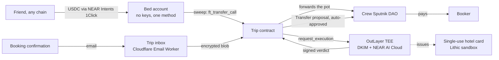

# Dibs

**Every bed paid before anyone books.** Group-trip money on NEAR: friends pay for their own bed from any
chain, nobody can book until every bed is paid, a dropout cannot get a refund but can sell their bed at face
value to someone already waiting, and the money is released only when the trip's own inbox receives a real,
verified booking confirmation.

**[Open the live Lisbon trip](https://preview.dibs-trips.pages.dev/t/lis0312)** ·
[Five-minute judge path](JUDGES.md) · [Threat model](docs/THREAT_MODEL.md) · `pnpm verify` (reads the chain, no keys)

Built at NEAR HACKATHON, November 2026. Runs on NEAR testnet; card rails are the Lithic sandbox (details in
[Honest limits](#honest-limits)).

## The problem

> "Last year, I had to pay $600 from my pocket as everyone was saying 'pay me later.' Only half of them actually
> paid me later, though." A group-trip organiser on Reddit, February 2026.

One friend books the place and then spends weeks chasing everyone. Shared pots move the problem instead of solving
it: now everyone has to trust whoever holds the pot, and whoever books.

## What Dibs does

| Rule | Enforced by |
|---|---|
| Nobody books until every bed is paid | The trip contract counts beds; the pot sits in the crew's own Sputnik DAO |
| Pay from any chain | Every bed is its own keyless NEAR account; NEAR Intents 1Click delivers USDC into it from Base, Solana, Arbitrum or Ethereum |
| No refunds. Sell your bed at face value | `request_refund` always fails with `E_NO_REFUND`; `list_for_resale` has no price parameter; a pre-funded waitlist buys the bed in the same call |
| The booker never holds the money | When every bed is paid, an OutLayer enclave issues the trip a single-use card that works only at hotels, up to the pot, sealed to the booker's passkey |
| Money moves only for a real booking | The confirmation lands in `<trip>@dibs.larinova.com`; OutLayer checks its DKIM signature in Intel TDX, NEAR AI Cloud reads it privately, the contract verifies the signed verdict, and the DAO pays |
| Beds are drawn fairly | OutLayer VRF output, verified by the contract, seeds the bed assignment |
| No booking by the deadline | Every bed is refunded automatically (`refund_all`) |

## Live on NEAR testnet

| What happened | Evidence |
|---|---|
| A **real booking.com confirmation** (Carlton City Hotel Singapore) verified on chain: DKIM `d=booking.com` checked in OutLayer TDX, read by NEAR AI Cloud, signature checked by the contract | [`54g9Y2qg…`](https://testnet.nearblocks.io/txns/54g9Y2qgKPNFamFeN6tQUgpR1AqU322F1J184LB8mYKr), trip `sin1025`: 25–26 Oct 2025, 2 guests, SGD 226.60 |
| The crew DAO paid the booker **226.60 USDC** with no vote, because the proof passed | `get_trip sin1025` → `payout: Done` |
| Beds drawn by **OutLayer VRF** | [`3RDs4qUK…`](https://testnet.nearblocks.io/txns/3RDs4qUK27Jfthi1NhNz7hsoYJtmh5N6j5o1BtjQfBSV), trip `lis0312` |
| A refund asked for and refused by the contract | `E_NO_REFUND`, see `pnpm verify` |
| The trip's own card: hotel charge **approved**, electronics charge **declined** | Lithic sandbox, issued by the enclave for `lis0312` (last4 0810) |
| Contract test suite | **46 of 46 checks pass, 35 of them attacks**, each refused with its own code ([judge-report.json](contracts/judge-report.json)) |

Every line above is re-checked by `pnpm verify`.

## How it works



- **Trip contract** (`contracts/dibs`, near-sdk 5): trips, beds, waitlist, resale, refunds, proofs. Every rejection
  carries a stable code (`E_*`) listed in [INTERFACE.md](contracts/INTERFACE.md).
- **Bed accounts** (`contracts/bed`): 2 KB raw wasm, no keys, one method that forwards exactly what arrived.
- **Verifier** (`outlayer/verifier`): a wasm32-wasip2 app for OutLayer. Ops: `booking` (DKIM, NEAR AI extraction,
  ed25519-signed facts), `vrf`, `card` (issues the Lithic card with a sealed key and seals the number to the booker).
- **API** (`services/api`, Cloudflare Worker): 1Click quotes and status, the gasless relayer (NEP-366, allowlisted
  methods only), encrypted proof blobs, names, activity.
- **Inbox** (`services/inbox`, Cloudflare Email Worker): unwraps forwarded-as-attachment emails byte for byte so
  DKIM still verifies.
- **App** (`apps/web`, React + ReUI): passkey-derived keys (WebAuthn PRF), no wallet, no gas.

## NEAR doing real work

| NEAR piece | Its job here |
|---|---|
| Sputnik DAO (+ Trezu view) | Holds each crew's pot; a `trip` role lets only the contract propose and approve the payout |
| NEAR Intents 1Click | Any-chain pay-in to a bed account, EXACT_OUTPUT quotes |
| OutLayer | Verifiable compute the contract itself calls: DKIM check, private extraction, VRF, card issuing |
| NEAR AI Cloud | Reads the booking email inside a GPU enclave (Qwen3.8-27B, TEE-signed responses) |
| Keyless accounts and NEP-366 | Bed accounts with no keys; friends act through signed delegate actions, gas paid by the relayer |

## Try it in five minutes

1. `pnpm install && pnpm verify` re-checks everything in the table above against testnet (no keys needed).
2. Open the [live Lisbon trip](https://preview.dibs-trips.pages.dev/t/lis0312) and the
   [Singapore trip](https://preview.dibs-trips.pages.dev/t/sin1025) → *See the booking proof*.
3. Run the attack suite: see [JUDGES.md](JUDGES.md) for the sandbox, verifier and API test commands.

## Run it yourself

```
apps/web          React app (Vite, ReUI Pro components)      pnpm --filter web dev
contracts/        dibs + bed contracts, sandbox tests         scripts/build.sh sandbox && (cd tests && cargo test)
outlayer/verifier OutLayer app                                cargo test --release
services/api      Cloudflare Worker API                       pnpm --filter dibs-api test
services/inbox    Cloudflare Email Worker                     pnpm --filter dibs-inbox test
film/             the demo film (Remotion)
```

Deployed ids are in [deploy/testnet.json](deploy/testnet.json); the deploy log is [DEPLOY-HANDBACK.md](DEPLOY-HANDBACK.md).

## Honest limits

- **Testnet.** NEAR Intents 1Click runs on mainnet only, so on testnet a faucet stands in for the cross-chain deposit.
- **Card rails are the Lithic sandbox.** The rules are real (single use, hotels only, limit = pot); the card network is simulated.
- **No FX yet.** The booking total is compared to the USDC cap one to one; the Singapore proof's SGD 226.60 was paid as 226.60 USDC.
- **VRF** is verifiable but not provably unpredictable to the enclave operator.
- **NEAR AI latency** varied from 10 to 49 s across runs; reasoning is turned off to keep it inside OutLayer's limit.
- Each trip address needs its own Email Routing rule (`services/inbox/scripts/add-trip-address.sh`).

## License

MIT. See [LICENSE](LICENSE).
